# Exercise 16 – First two Spring Framework apps

Akademia Finansów i Biznesu Vistula

This repository contains both applications from Exercise 16:

| Folder | Task | Description |
|---|---|---|
| [`first-project-java-spring`](first-project-java-spring) | Task 1 | First Spring Boot MVC app (controller, `@ResponseBody`, Thymeleaf view, static image) |
| [`First-Rest-Api-Spring`](First-Rest-Api-Spring) | Task 2.A – 2.H | REST API for products (CRUD, Swagger, exception handling, H2 + Spring Data JPA) |

**Environment:** Java 21, Spring Boot 4.2.0, Maven, IntelliJ IDEA.

**How to run:** open the project's `pom.xml` in IntelliJ IDEA (JDK 21), reload Maven, then run the `...Application` class. You can also use the Maven Wrapper from the project's folder:

```powershell
.\mvnw.cmd spring-boot:run
```

Both apps use port `8080`, so stop one before starting the other.

---

## Task 1 – first-project-java-spring

The project was generated with [start.spring.io](https://start.spring.io/) using the **Spring Web**, **Lombok** and **Thymeleaf** dependencies.

### HelloController

```java
@Controller
public class HelloController {

    @GetMapping(value = "/")
    @ResponseBody
    public String hello() { return "Hello Vistula, in my first Spring controller."; }

    @GetMapping("/greeting")
    public String greeting(@RequestParam(name="name", required=false, defaultValue="World") String name, Model model) {
        model.addAttribute("name", name);
        return "greeting";
    }
}
```

**About `@ResponseBody`:** a method in a `@Controller` class returns the **name of a view** by default. For example, `"greeting"` is resolved to `templates/greeting.html`. Adding `@ResponseBody` tells Spring to write the returned value **directly into the HTTP response body** instead of looking for a template. That is why `hello()` returns plain text and `greeting()` returns an HTML page. `@RestController` is the same as `@Controller` with `@ResponseBody` on every method.

The view [`greeting.html`](first-project-java-spring/src/main/resources/templates/greeting.html) uses Thymeleaf (`th:text`) to show the `name` attribute from the `Model`. It also shows the image `static/images/vistula.png`.

| `localhost:8080/greeting?name=Vistula` | `localhost:8080/greeting` (default value) |
|---|---|
| 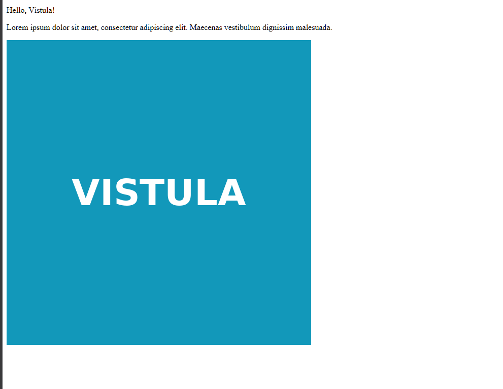 | 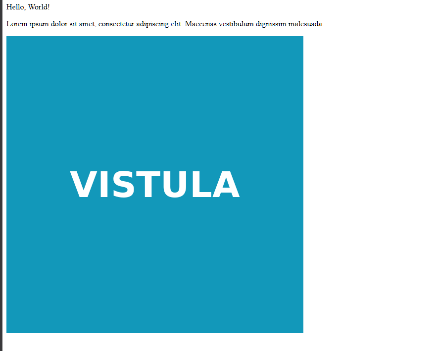 |

---

## Task 2 – First-Rest-Api-Spring

The project was created with Spring Initializr in IntelliJ IDEA using the **Spring Web**, **H2 Database**, **Spring Data JPA** and **Spring Boot DevTools** dependencies.

### Project structure

```
pl.edu.vistula.firstrestapispring
├── product
│   ├── api
│   │   ├── request    → ProductRequest, UpdateProductRequest
│   │   ├── response   → ProductResponse
│   │   └── ProductController
│   ├── domain         → Product
│   ├── repository     → ProductRepository (OldProductRepository = old HashMap version)
│   ├── service        → ProductService
│   └── support        → ProductMapper, ProductExceptionSupplier, ProductExceptionAdvisor
│       └── exception  → ProductNotFoundException
├── shared.api.response → ErrorMessageResponse
└── FirstRestApiSpringApplication
```

### 2.A – Classes and the POST endpoint

| Class | Role |
|---|---|
| `Product` | Domain class, the subject of the `product` package (`id`, `name`). |
| `ProductRepository` | Saves and reads data. At first it was a `HashMap` pretending to be a database, with a `counter` that generates ids. |
| `ProductRequest` / `ProductResponse` | Java objects that the JSON request body is converted to and the JSON response is created from. |
| `ProductMapper` (`@Component`) | Copies data between objects: `ProductRequest → Product` and `Product → ProductResponse`. |
| `ProductService` (`@Service`) | Business logic. It maps the request, saves the product in the repository and maps the result to a response. |
| `ProductController` (`@RestController`) | Receives HTTP requests on `/api/v1/products` and returns `ResponseEntity` objects with the right status. |

**Request flow:** Postman sends `POST /api/v1/products` with `{"name":"First product"}`. Because of `@RequestBody`, Spring converts the JSON into a `ProductRequest`. The controller calls `productService.create()`. The service uses the mapper to create a `Product`, saves it with `productRepository.save()` (which assigns the id), and maps the saved product to a `ProductResponse`. The controller wraps the response in a `ResponseEntity` with status **201 Created**.

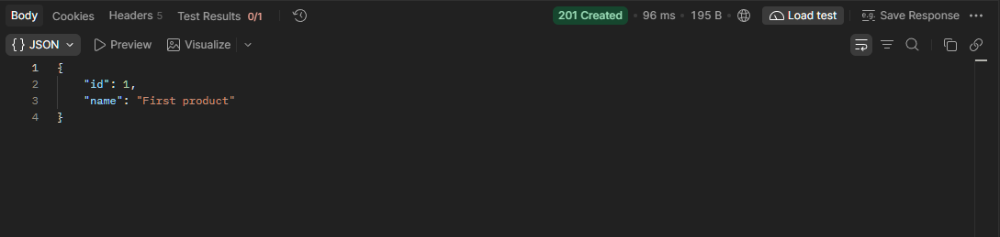

### 2.B – Swagger UI

The `springdoc-openapi-starter-webmvc-ui` dependency was added, and `@OpenAPIDefinition` was added to the main class:

```java
@OpenAPIDefinition(info = @Info(title = "Products API for Vistula", version = "1.0", description = "Products Information"))
```

The API documentation is available at `localhost:8080/swagger-ui/index.html` (UI) and `localhost:8080/v3/api-docs` (JSON).

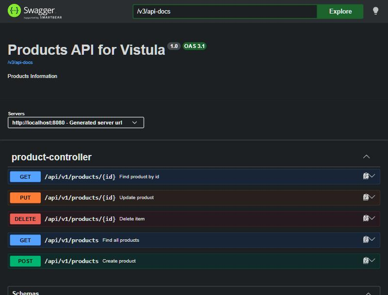
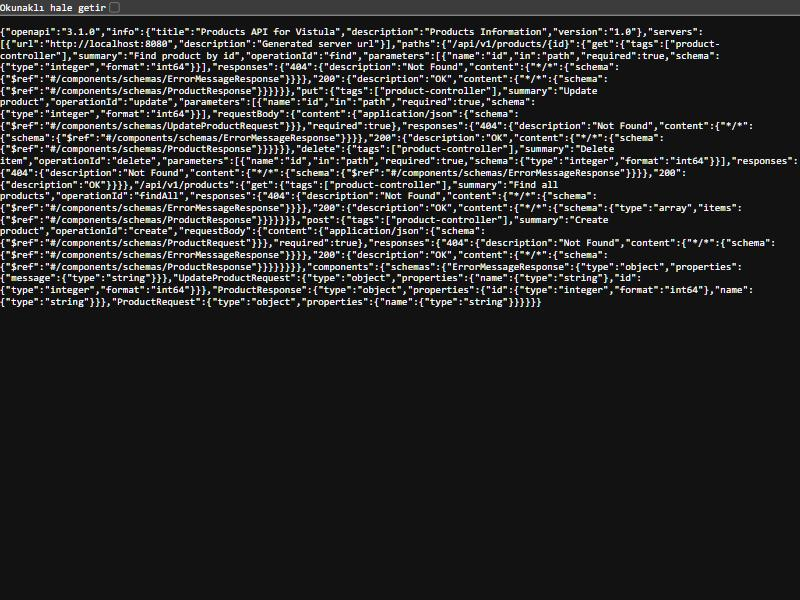

### 2.C – GET by id

```java
@GetMapping("/{id}")
@Operation(summary = "Find product by id")
public ResponseEntity<ProductResponse> find(@PathVariable Long id){
    ProductResponse productResponse = productService.find(id);
    return ResponseEntity.status(HttpStatus.OK).body(productResponse);
}
```

`@GetMapping("/{id}")` handles `GET /api/v1/products/{id}`. `@PathVariable` copies the `{id}` part of the path into the `Long id` parameter. The service calls `findById()`, which returns an `Optional<Product>`. If the product exists, it is returned with status **200 OK**. If it does not exist, `orElseThrow()` throws an exception.

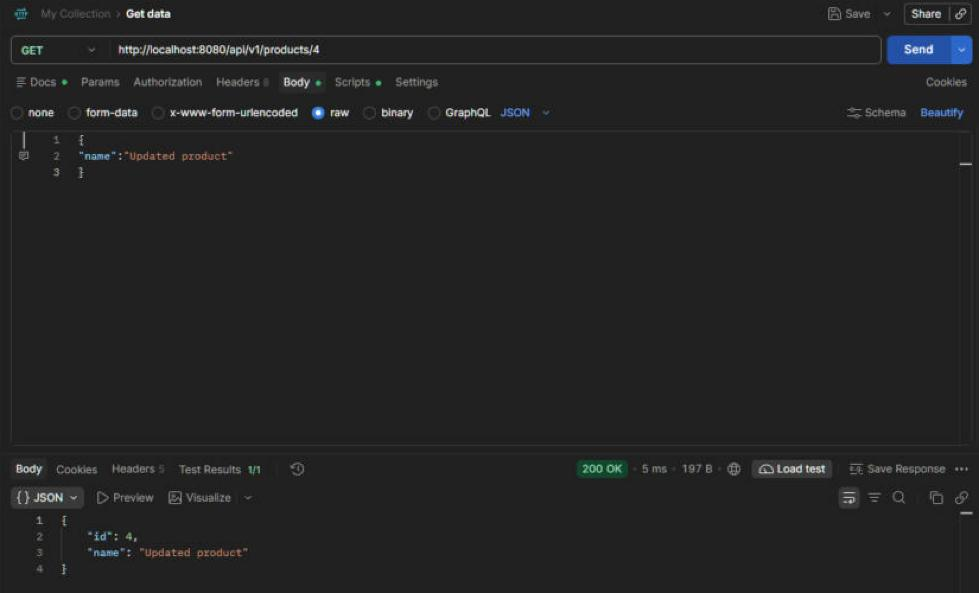

### 2.D – Exception handling

- `ProductNotFoundException` builds the message with `String.format("Product with %d not found", id)`.
- `ProductExceptionSupplier.productNotFound(id)` returns a `Supplier<ProductNotFoundException>` for `orElseThrow()`.
- `ProductExceptionAdvisor` (`@ControllerAdvice`) catches the exception with `@ExceptionHandler` and returns **404 Not Found** with an `ErrorMessageResponse` body instead of a generic **500** error.

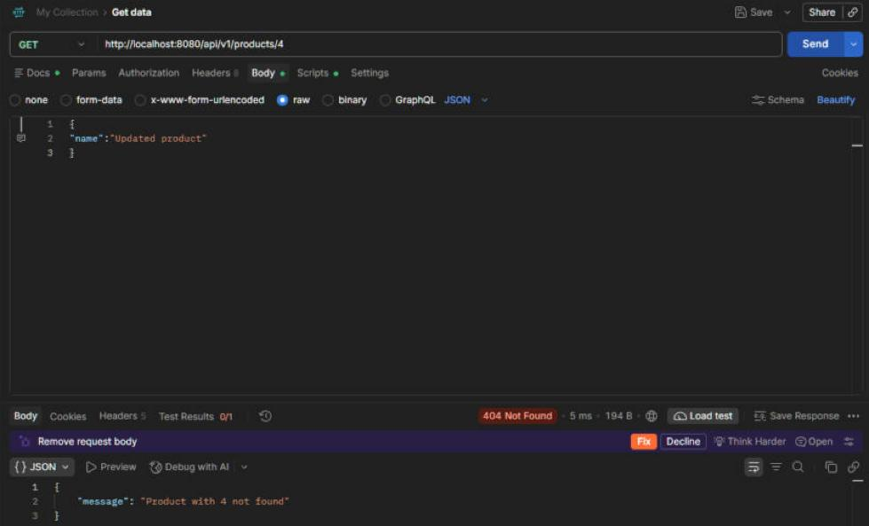

### 2.E – PUT (update)

`PUT /api/v1/products/{id}` uses `UpdateProductRequest`. The service finds the product (or returns 404), changes the name with `ProductMapper.toProduct(product, updateProductRequest)`, saves it and returns **200 OK**. In the old HashMap repository, `setId()` overwrote the existing entry when the object already had an id and generated a new id otherwise.

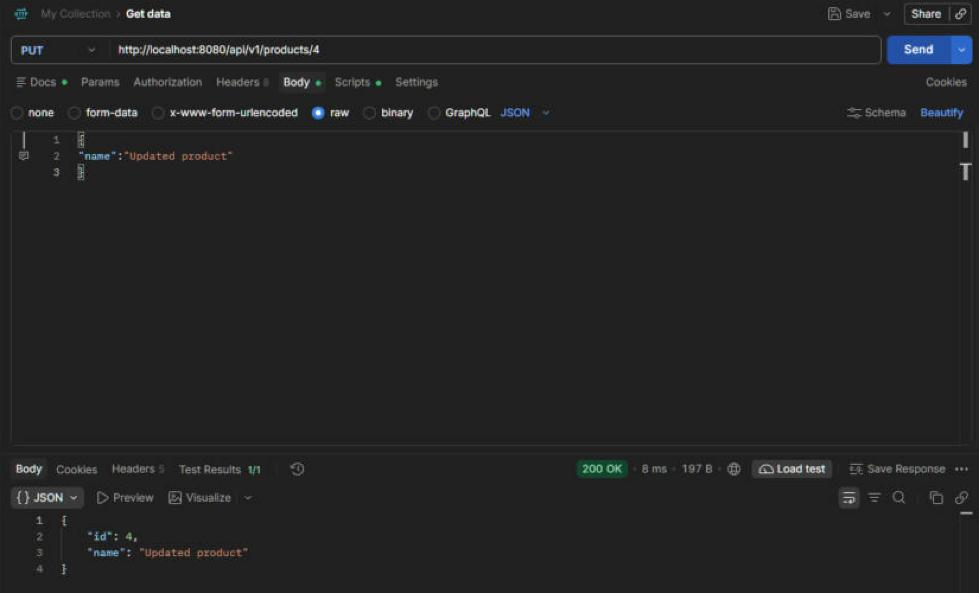

### 2.F – GET all and DELETE

- `GET /api/v1/products`: `findAll()` maps every `Product` to a `ProductResponse` with a stream and returns the list with **200 OK**. If there are no products, it returns an empty list, so no exception handler is needed.
- `DELETE /api/v1/products/{id}`: the service first checks that the product exists (404 otherwise), then calls `deleteById()`. The controller returns **204 No Content**.

| DELETE → 204 No Content | GET all → 200 OK |
|---|---|
| 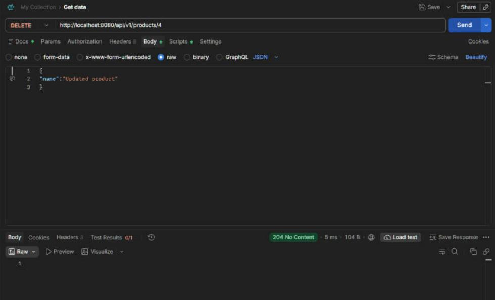 | 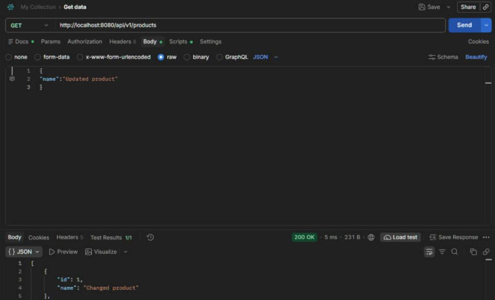 |

### 2.G – Database (H2 + Spring Data JPA / Hibernate)

`application.properties`:

```properties
spring.h2.console.enabled=true
spring.h2.console.path=/console/
spring.datasource.url=jdbc:h2:mem:testdb

logging.level.org.hibernate.SQL=DEBUG
```

`Product` became a JPA entity:

```java
@Entity(name = "products")
public class Product {
    @Id
    @GeneratedValue
    private Long id;
    private String name;

    public Product() { }
    ...
}
```

`ProductRepository` is now a single interface. The old HashMap class was kept as `OldProductRepository`.

```java
@Repository
public interface ProductRepository extends JpaRepository<Product, Long> {
}
```

#### Question: why does `ProductService` still work although `ProductRepository` is empty?

`ProductRepository` extends `JpaRepository<Product, Long>`. That interface, through its parent interfaces (`ListCrudRepository`, `CrudRepository`, `PagingAndSortingRepository`, …), already **declares** `save`, `findById`, `findAll`, `deleteById` and other methods, so the compiler sees them through inheritance. When the application starts, **Spring Data JPA** scans for repository interfaces and **generates an implementation at runtime**: a proxy backed by `SimpleJpaRepository`, which uses Hibernate's `EntityManager`. The type parameters tell it which entity (`Product`) and id type (`Long`) to use. This implementation is registered as a Spring bean and injected into `ProductService` through its constructor (dependency injection). Therefore we never have to write the implementation ourselves.

### 2.H – Final tests

Products were created, read, updated and deleted through the API. The H2 console (`localhost:8080/console`, JDBC URL `jdbc:h2:mem:testdb`, user `sa`, empty password) shows the `PRODUCTS` table: product 1 was updated to "Changed product" and product 2 was deleted.

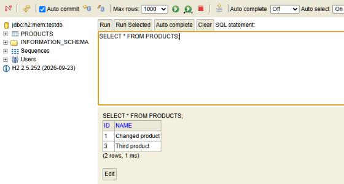

---

## Notes / differences from the slides

- **Spring Boot 4.2.0** (latest version at the time) is used instead of 3.0.x. Because of this, Swagger uses **springdoc-openapi 3.1.1**, since version 2.0.0 from the slides only works with Spring Boot 3.0.
- `@JsonProperty` was added to the request constructors so that JSON binding works with the newer Jackson version.
- `ProductResponse` has a `getId()` method so that `"id"` appears in the JSON response, as in the slide's screenshot.
